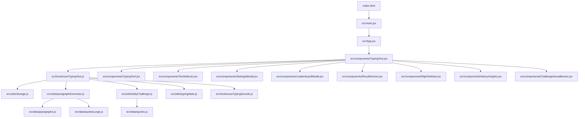

<div align="center">

# ⌨️ GoType

### A Competitive Typing Practice App — React, Vite & Framer Motion

<p>
  
  
  
</p>

<p>
  
  
  
  
  
  
</p>

Classic typing tests, quote & custom practice, daily **Challenge Arena** runs with badge progression, live stats, leaderboards, and an SEO-ready deploy setup.

[Live Demo](#) · [Report Bug](#) · [Request Feature](#)

</div>

<br/>


<br/>

## 📌 Table of Contents

- [Overview](#-overview)
- [Screenshots](#-screenshots)
- [Tech Stack](#-tech-stack)
- [Core Features](#-core-features)
- [Challenge Arena](#-challenge-arena)
- [Badge System](#-badge-system)
- [Architecture](#-architecture)
- [User Flow](#-user-flow)
- [Folder Structure](#-folder-structure)
- [Persistence Model](#-persistence-model)
- [Getting Started](#-getting-started)
- [Testing](#-testing)
- [Deployment & SEO](#-deployment--seo)
- [Keyboard Shortcuts](#-keyboard-shortcuts)
- [Changelog](#-changelog)
- [Roadmap](#-roadmap)

<br/>

## 🧭 Overview

| | |
|---|---|
| 🟢 **Status** | Active, in development |
| ⌨️ **Core modes** | Time, Words, Goal (Sustain/Reach), Quote, Custom, Numbers |
| 🏟️ **Challenge Arena** | Daily locked challenges — endurance, no-backspace, speed spike, memory fade, and more |
| 🏅 **Progression** | Multi-tier badge system with repeat-earn multipliers |
| 📊 **Tracking** | Live WPM/accuracy, per-mode best scores, history, leaderboard |
| 🧪 **Tests** | Vitest + jsdom covering challenge logic, storage, and typing stats |
| 🚀 **Deploy** | Vercel-ready with sitemap generation and clean routing |

<br/>

## 🖼️ Screenshots

> Images live in `/screenshots` at the project root.

<table>
  <tr>
    <td width="50%"><p align="center"><sub>Typing Test — Classic Core</sub></p></td>
    <td width="50%"><p align="center"><sub>Challenge Arena</sub></p></td>
  </tr>
  <tr>
    <td width="50%"><p align="center"><sub>Result Screen</sub></p></td>
    <td width="50%"><p align="center"><sub>Badge Gallery</sub></p></td>
  </tr>
  <tr>
    <td width="50%"><p align="center"><sub>Leaderboard</sub></p></td>
    <td width="50%"><p align="center"><sub>Theme</sub></p></td>
  </tr>
</table>

<br/>

## 🧰 Tech Stack

<table>
<tr>
<td valign="top" width="50%">

**Core**
- React 18
- Vite (dev, build, bundling)
- Tailwind CSS
- Framer Motion (transitions & motion)
- Lucide React (icons)
- canvas-confetti (celebration effects)

</td>
<td valign="top" width="50%">

**Testing & Build**
- Vitest
- jsdom + Testing Library
- vite-plugin-sitemap
- Custom post-build sitemap sanitizer

</td>
</tr>
</table>

**Browser/platform APIs used directly:** `localStorage` (persistence), `AudioContext` (sound), `requestAnimationFrame` (scroll sync), resize/scroll listeners (layout-aware overlays).

> Note: Recharts is **not** part of the current dependency tree — the result performance view is built with GoType's own UI and animation code.

<br/>

## ✨ Core Features

<details open>
<summary><strong>⌨️ Classic Core</strong></summary>

- **Time** mode — configurable duration presets + custom input
- **Words** mode — preset word counts + custom numeric field
- **Goal** mode — *Sustain* (hold target WPM for a window) and *Reach* (complete the prompt while meeting target)
- Best WPM tracked separately per mode + variant

</details>

<details>
<summary><strong>📝 Quote, Custom & Numbers</strong></summary>

- **Quote** — punctuation and rhythm practice from a large local quote bank
- **Custom** — paste any text and practice it directly
- **Numbers** — mixed numeric typing drills

</details>

<details>
<summary><strong>📊 Live Performance Tracking</strong></summary>

- Continuously updating WPM, accuracy, time remaining, and word progress
- Result screen with a recent-performance visualization
- History & Insights: recent results, mistake heatmap summary, CSV export

</details>

<details>
<summary><strong>🖱️ Auto-Scroll</strong></summary>

- Custom margin-aware scroll calculation (not a plain `scrollIntoView`)
- User-adjustable bottom margin (default 50px) via Settings
- Respects manual scrolling instead of fighting the user
- Resynchronizes automatically as long endless sessions grow

</details>

<details>
<summary><strong>🔊 Sound & Theme</strong></summary>

- Keypress, error, and milestone sounds via Web Audio
- Volume control with persisted mute/unmute state
- Dark/light theme, persisted across sessions

</details>

<details>
<summary><strong>🏆 Leaderboard & Streaks</strong></summary>

- Filter by mode and Goal variant, sort by WPM/accuracy
- High-accuracy result curation (Goal Reach enforces stricter completion rules)
- Sidebar tracks streaks, daily goal progress, and current best WPM

</details>

<br/>

## 🏟️ Challenge Arena

The competitive layer — daily, seeded, rule-driven challenges:

| Challenge Family | Rule Focus |
|---|---|
| **Endurance** | Sustained typing over longer runs |
| **No-Backspace / Control** | Zero-correction accuracy pressure |
| **Speed Spike** | Hit and sustain a target WPM window |
| **Perfectionist** | High-accuracy completion |
| **Numbers** | Numeric-heavy precision drills |
| **Memory** | Prompt hides after a delay, then fades word-by-word |

**How it works:**
- Daily templates are generated from a seeded catalog — same day, same challenge, every time it's loaded
- A reuse window prevents the same challenge resurfacing too soon
- Runs can require minimum WPM, minimum accuracy, specific time limits, sustain thresholds, or no-backspace constraints
- **Memory challenges** hide the prompt after `hideAfterSeconds` (~3s in current templates), then progressively fade unfaded words while the user is idle — completion is only valid if the prompt was actually hidden/faded during the run
- **Attempt limit:** 3 failed attempts per day trigger a lock overlay that blocks further typing until the next day

<br/>

## 🏅 Badge System

- Multiple badge **families**, each with **5 tiers**, plus standalone milestone badges
- Badge records persist in `localStorage`, sanitized on load (`badgeId`, `name`, `iconName`, `earnedCount`, optional challenge metadata)
- Repeated completions increment `earnedCount`, shown as multipliers (×2, ×3, …)
- Icons are **Lucide icon names**, not custom bitmap art
- Full browsable collection in the **Badge Gallery** (earned, locked, and repeated states)

<br/>

## 🏗️ Architecture

The app is split into a presentation layer and a state/engine layer.



**Engine** (`useTypingTest.js`) — the central controller: loads persisted settings, generates prompts, tracks typed text/correctness/cursor/time, computes WPM/accuracy, applies Arena rules, appends content for endless sessions, and persists results.

**UI** (`TypingTest.jsx`) — the page-level orchestrator: connects the hook to the interface, renders header/selector/stats/typing area/sidebar, owns modal state, and controls keyboard shortcuts and focus.

**Prompt renderer** (`TypingText.jsx`) — tokenizes and renders words/characters, highlights correctness and cursor position, and manages custom scroll anchoring.

<br/>

## 🔄 User Flow

1. `index.html` loads → mounts React via `src/main.jsx`
2. `App.jsx` reads saved theme and applies the shell
3. `TypingTest.jsx` renders the workspace, selector, stats, sidebars, dialogs, Arena overlays
4. `useTypingTest.js` generates the prompt, runs the timer, captures input, computes live stats
5. User selects a mode and types — live feedback updates continuously
6. In Challenge Arena: memory fades, no-backspace enforcement, attempt locking, and badge awards can all trigger
7. On completion, `ResultScreen.jsx` shows the outcome, bests, and recent performance
8. History, leaderboard, badge gallery, settings, and onboarding stay accessible throughout

<br/>

## 📁 Folder Structure

```
src/
├─ App.jsx / main.jsx / legal.jsx / index.css
├─ components/
│  ├─ TypingTest.jsx          # Main orchestrator
│  ├─ TypingText.jsx          # Prompt renderer + scroll anchoring
│  ├─ TextSelector.jsx        # Mode selector (Classic/Quotes/Custom/Numbers)
│  ├─ ChallengeArenaBanner.jsx / ChallengeCard.jsx
│  ├─ RightSidebar.jsx / SidebarModal.jsx
│  ├─ SettingsModal.jsx / LeaderboardModal.jsx
│  ├─ HistoryInsights.jsx / ResultScreen.jsx
│  ├─ BadgeGalleryModal.jsx / WelcomeTour.jsx
│  ├─ Footer.jsx / LegalPage.jsx / SoundControls.jsx
│  ├─ GoalModeSettings.jsx / Stats.jsx / AppLogo.jsx
│  └─ ModeSwitcher.jsx        # legacy — superseded by TextSelector.jsx
├─ constants/
│  └─ typingModes.js
├─ data/
│  ├─ paragraphs.js / quotes.js / quotesLarge.js
├─ hooks/
│  ├─ useTypingTest.js        # Core engine
│  └─ useTypingSounds.js
└─ utils/
   ├─ storage.js               # localStorage access + sanitization
   ├─ paragraphGenerator.js
   ├─ dailyChallenge.js        # Seeded daily Arena content
   ├─ typingStats.js           # WPM / accuracy math
   └─ __tests__/
      ├─ dailyChallenge.test.js
      ├─ storage.test.js
      └─ typingStats.test.js
```

<br/>

## 💾 Persistence Model

Everything lives in `localStorage`:

| Category | Contents |
|---|---|
| **Preferences** | Theme, sound on/off + volume, scroll margin, onboarding-seen flag, mode/goal preferences |
| **Performance** | Best WPM by mode, recent results, leaderboard entries |
| **Progression** | Badge collection (`badgeId`, `name`, `iconName`, `earnedCount`, metadata) |
| **Streaks** | Streak info, daily goal state, daily Arena attempt count |

**Result records** include mode key, word count/time limit, Goal variant, WPM, accuracy, correct/incorrect character counts, time used, and Challenge-specific flags (completion, failure, text-fade usage, prompt-hidden usage).

<br/>

## 🚀 Getting Started

### Install

```bash
npm install
```

### Development server

```bash
npm run dev
```

### Production build

```bash
npm run build
```
Runs `vite build && node scripts/fix-sitemap.mjs` under the hood.

### Preview

```bash
npm run preview
```

<br/>

## 🧪 Testing

```bash
npm run test
```

Current coverage focuses on the utility layer (Vitest + jsdom):

- `dailyChallenge.test.js` — challenge generation & validation
- `storage.test.js` — persistence & sanitization
- `typingStats.test.js` — WPM/accuracy calculations

<br/>

## 🌐 Deployment & SEO

Built for **Vercel**, with:

- `vercel.json` for clean routes + legacy `.html` compatibility
- `index.html` with Open Graph, Twitter Card, structured data, and `robots` indexing
- Dedicated `legal.html`, `privacy.html`, `terms.html`, `contact.html` with page-specific metadata
- `public/robots.txt` pointing to the sitemap
- `public/manifest.json` for installable web-app support
- `public/og-image.png` social preview image
- Sitemap generated during build, sanitized by `scripts/fix-sitemap.mjs`

<br/>

## ⌨️ Keyboard Shortcuts

| Shortcut | Action |
|---|---|
| `Ctrl/Cmd + Shift + R` | Restart |
| `Ctrl/Cmd + Shift + S` | Toggle sound |

> **Note:** `Escape` is not globally wired yet — modals close via their explicit controls/overlay actions.

<br/>

## 📋 Changelog

**Recent improvements:**
- Challenge Arena hardened — daily unique templates, rule validation, badge rewards, attempt locking
- Memory-test behavior expanded — per-word fading after an idle delay
- Auto-scroll rewritten — configurable bottom margin, manual-scroll respect, append-aware resync
- Result screen — more engaging recent-performance visualization
- SEO upgrade — titles, descriptions, canonical structure, manifest, structured data, robots.txt, sitemap
- Static policy pages aligned with clean routing for deployment
- Welcome tour updated to reflect the current layout (Arena sidebar, modern top controls)

<br/>

## 🗺️ Roadmap

- [ ] Wire `Escape` globally for modal dismissal
- [ ] Add pagination/grouping to the Badge Gallery as the catalogue grows
- [ ] Evaluate a charting library if the performance visualization needs more depth (not currently using Recharts)

<br/>

<div align="center">

**⭐ If you found this useful, consider giving it a star!**

</div>