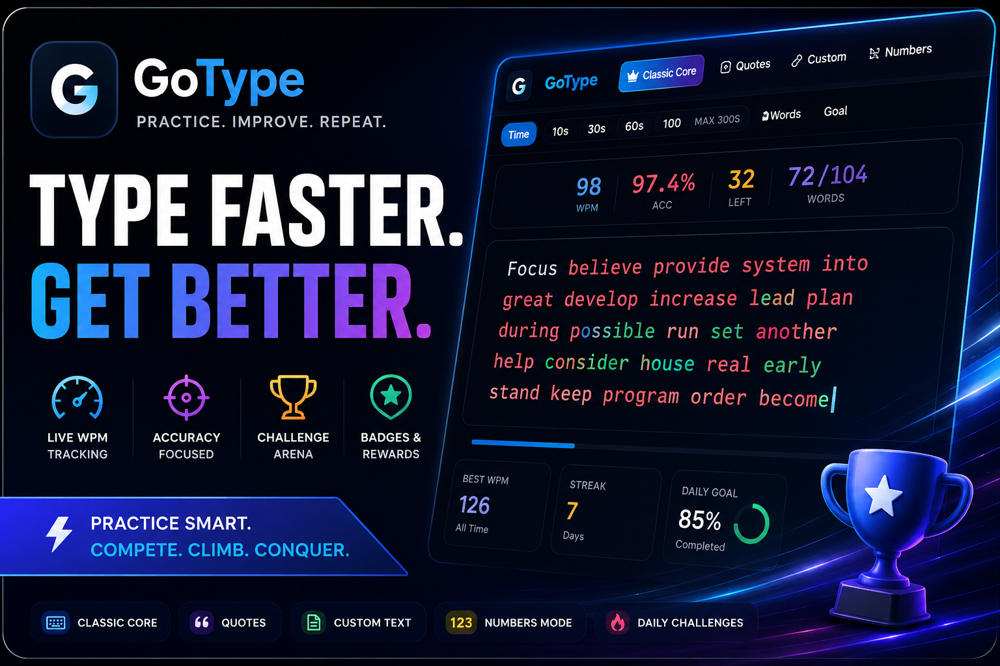
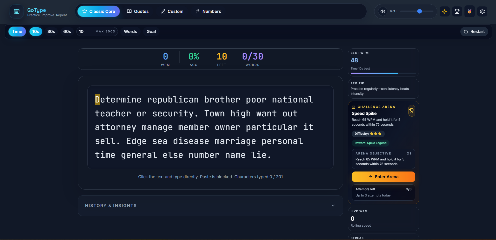
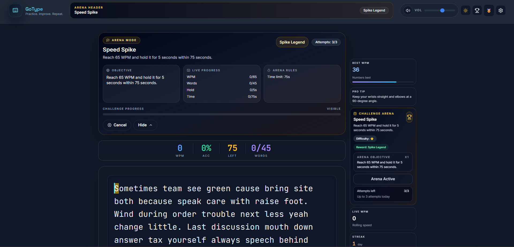
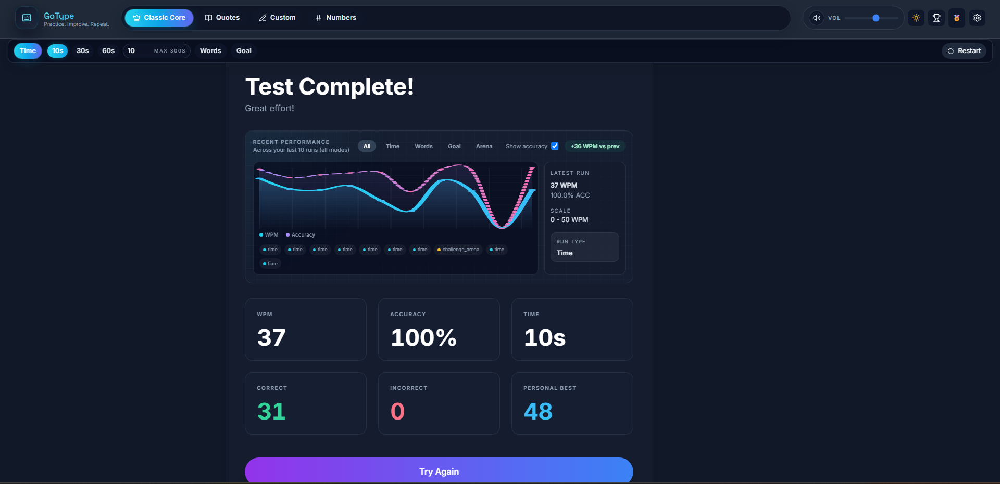
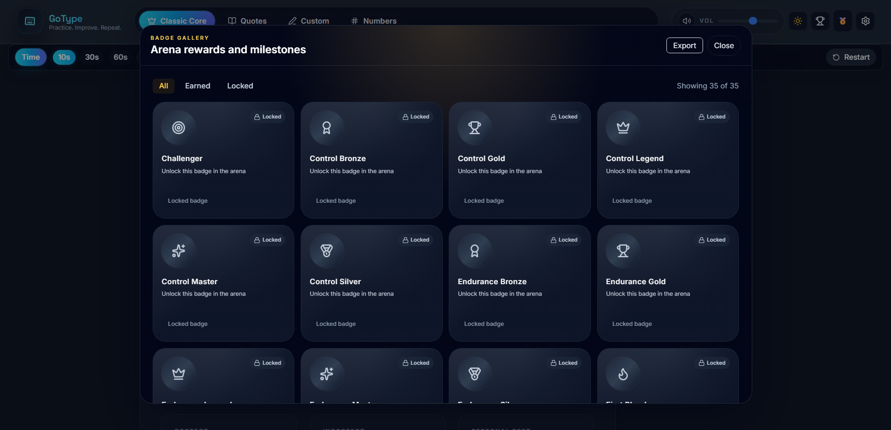
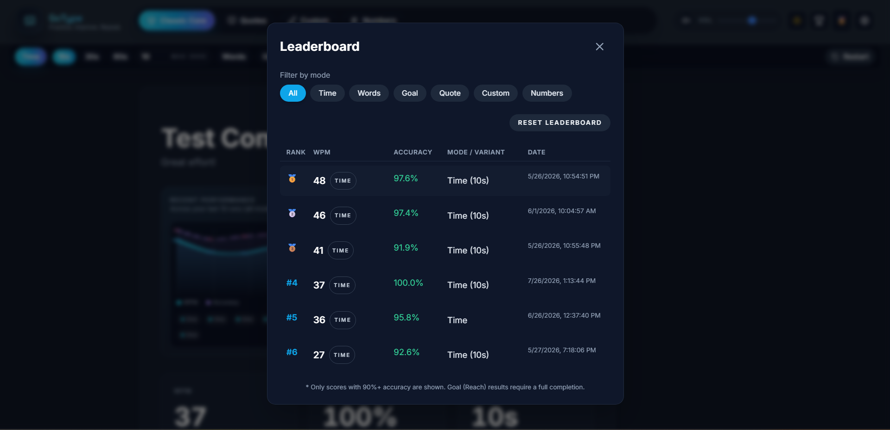
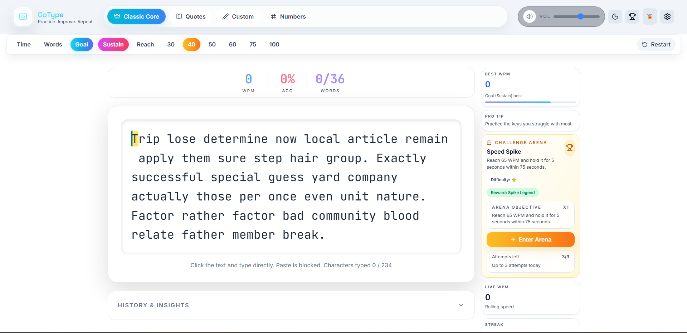
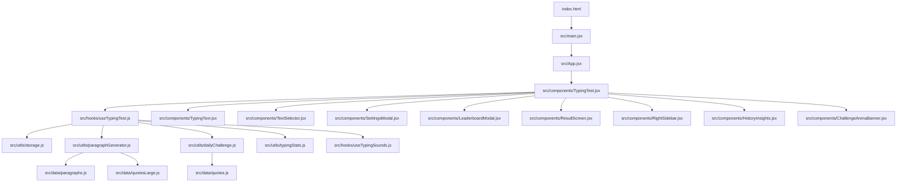

<div align="center">


<a href="https://readme-typing-svg.demolab.com">
  
</a>

<br/><br/>

<p>
  
  
  
  
</p>

<p>
  
  
  
  
  
  
</p>

<h3>Classic typing tests, quote & custom practice, daily <b>Challenge Arena</b> runs with badge progression, live stats, leaderboards, and an SEO-ready deploy setup.</h3>

<p>
  <a href="#-overview"><b>Overview</b></a> ·
  <a href="#-screenshots"><b>Screenshots</b></a> ·
  <a href="#-core-features"><b>Features</b></a> ·
  <a href="#-challenge-arena"><b>Arena</b></a> ·
  <a href="#-getting-started"><b>Get Started</b></a> ·
  <a href="#-roadmap"><b>Roadmap</b></a>
</p>

</div>

<br/>



<br/>

## 🧭 Overview

<div align="center">

| ⌨️ Modes | 🏟️ Arena | 🏅 Progression | 📊 Tracking | 🧪 Tests | 🚀 Deploy |
|:---:|:---:|:---:|:---:|:---:|:---:|
| Time · Words · Goal · Quote · Custom · Numbers | Daily locked challenges, seeded & rule-driven | Multi-tier badges, repeat-earn multipliers | Live WPM/accuracy, history, leaderboard | Vitest + jsdom | Vercel + auto sitemap |

</div>

<br/>

## 🖼️ Screenshots

<div align="center"><i>Images live in <code>/screenshots</code> at the project root.</i></div>
<br/>

<table>
  <tr>
    <td width="50%"><p align="center"><sub><b>Typing Test</b> — Classic Core</sub></p></td>
    <td width="50%"><p align="center"><sub><b>Challenge Arena</b></sub></p></td>
  </tr>
  <tr>
    <td width="50%"><p align="center"><sub><b>Result Screen</b></sub></p></td>
    <td width="50%"><p align="center"><sub><b>Badge Gallery</b></sub></p></td>
  </tr>
  <tr>
    <td width="50%"><p align="center"><sub><b>Leaderboard</b></sub></p></td>
    <td width="50%"><p align="center"><sub><b>Dark / Light Theme</b></sub></p></td>
  </tr>
</table>

<br/>

## 🧰 Tech Stack

<div align="center">

**Core**


**Testing & Build**


**Platform APIs used directly**


</div>

> ℹ️ Recharts is **not** part of the dependency tree — charts are hand-built SVG.

**Design:** "Wine & Periwinkle" palette (indigo inks, periwinkle primary, sand accents; sand + wine in light theme). Fonts: Sora (display), Inter (body), JetBrains Mono (typing).

<br/>

## ✨ Core Features

<table>
<tr>
<td width="50%" valign="top">

### ⌨️ Classic Core
- **Time** — duration presets + custom input
- **Words** — preset counts + custom numeric field
- **Goal** — *Sustain* (hold target WPM) & *Reach* (complete while meeting target)
- Best WPM tracked per mode + variant

</td>
<td width="50%" valign="top">

### 📝 Quote / Custom / Numbers
- **Quote** — rhythm & punctuation from a large local bank
- **Custom** — paste any text to practice
- **Numbers** — mixed numeric drills

</td>
</tr>
<tr>
<td width="50%" valign="top">

### 📊 Live Performance Tracking
- Continuous WPM, accuracy, time remaining, word progress
- **WPM-over-time chart** on every result, with average and personal-best lines
- History & Insights — keys-you-miss heatmap, CSV export

### 🎯 Practice Tools
- **Weak-key drills** generated from the keys you miss most
- **Ghost cursor** replays your personal-best pace for the current mode
- Share your result (native share sheet or clipboard)

</td>
<td width="50%" valign="top">

### नेपाली Nepali Typing

Switch the language bar above the typing panel to **नेपाली** to practice Nepali (Devanagari) in every classic mode (Time, Words, Quotes, Numbers, Goal).

- **Built-in Nepali layout:** uses the physical key you press (`KeyboardEvent.code`), like Monkeytype's layout emulator, so it works with any OS keyboard and needs no setup. The mapping follows the standard Nepali layout from xkeyboard-config (`symbols/np`, "basic"); every key produces exactly one Unicode character. Choose **My system keyboard** to use a Nepali keyboard installed in your OS instead.
- **On-screen keyboard:** shows the next key, whether Shift is needed, and flashes green/red on each press. Toggle it with the **Keyboard** button.
- **Finger hints:** a hand diagram plus a sentence ("Hold Shift with your right pinky, press T with your left index finger"), colour-matched to the keys. Toggle with **Finger hints**.
- **Learn Nepali typing:** 13 guided lessons (home row, top/bottom rows, vowel signs, Shift consonants, halant and conjuncts, digits, everyday words).
- Nepali personal bests are tracked separately from English (`ne_*` keys). Weak-key drills only use your Nepali mistakes while Nepali is selected.
- WPM uses the usual 5 characters per word, counted per Unicode character.

### 🖱️ Smart Auto-Scroll
- Custom margin-aware scroll (not plain `scrollIntoView`)
- Adjustable bottom margin (default 50px)
- Respects manual scrolling
- Resyncs automatically on long endless sessions

</td>
</tr>
<tr>
<td width="50%" valign="top">

### 🔊 Sound & Theme
- Keypress / error / milestone sounds via Web Audio
- Volume control, persisted mute state
- Dark/light theme, persisted across sessions

</td>
<td width="50%" valign="top">

### 🏆 Leaderboard & Streaks
- Filter by mode + Goal variant, sort by WPM/accuracy
- High-accuracy curation (Goal Reach is stricter)
- Sidebar streaks + daily goal progress

</td>
</tr>
</table>

<br/>

## 🏟️ Challenge Arena

<div align="center">

```
        ┌─────────────────────────────────────────┐
        │        🎯 DAILY SEEDED CHALLENGE          │
        │     Same day → same challenge, always     │
        └─────────────────────────────────────────┘
                            │
        ┌───────────────────┼───────────────────┐
        ▼                   ▼                   ▼
   🏃 Endurance      🚫 No-Backspace       ⚡ Speed Spike
  Sustained runs      Zero-correction      Hit + sustain
                        pressure            target WPM
        │                   │                   │
        ▼                   ▼                   ▼
   🎯 Perfectionist    🔢 Numbers          🧠 Memory
  High-accuracy       Numeric-heavy        Prompt hides,
   completion            drills          then fades word-by-word
```

</div>

| Rule | Behavior |
|---|---|
| **Reuse window** | Prevents the same challenge resurfacing too soon |
| **Run constraints** | Minimum WPM, minimum accuracy, time limits, sustain thresholds, no-backspace |
| **Memory fade** | Prompt hides after `hideAfterSeconds` (~3s), then fades unfaded words while idle — only counts as complete if hide/fade actually occurred |
| **Attempt cap** | 3 failed attempts/day → 🔒 lock overlay blocks typing until the next day |

<br/>

## 🏅 Badge System

<div align="center">


</div>

- Persisted in `localStorage`, sanitized on load — `badgeId`, `name`, `iconName`, `earnedCount`, optional challenge metadata
- Repeat completions increment `earnedCount`, displayed as multipliers
- Icons are **Lucide icon names** — no custom bitmap art
- Full browsable **Badge Gallery** (earned / locked / repeated states)

<br/>

## 🏗️ Architecture

<div align="center"><i>Presentation layer + state/engine layer, cleanly separated.</i></div>



<table>
<tr><td width="33%" valign="top">

**🧠 Engine**
`useTypingTest.js`

Loads settings, generates prompts, tracks input/correctness/cursor/time, computes WPM/accuracy, applies Arena rules, appends endless content, persists results.

</td>
<td width="33%" valign="top">

**🖥️ UI Orchestrator**
`TypingTest.jsx`

Connects the hook to the interface, renders header/selector/stats/typing area/sidebar, owns modal state, controls shortcuts and focus.

</td>
<td width="33%" valign="top">

**✍️ Prompt Renderer**
`TypingText.jsx`

Tokenizes/renders words & characters, highlights correctness and cursor, manages custom scroll anchoring.

</td>
</tr>
</table>

<br/>

## 🔄 User Flow

<div align="center">

`index.html` → `main.jsx` → `App.jsx` (theme) → `TypingTest.jsx` (workspace) → `useTypingTest.js` (engine)
→ **user types** → live feedback → *(Arena: fades / locks / badges)* → `ResultScreen.jsx` → history · leaderboard · badges · settings

</div>

<br/>

## 📁 Folder Structure

```
src/
├─ App.jsx / main.jsx / legal.jsx / index.css
├─ components/
│  ├─ TypingTest.jsx          # Main orchestrator
│  ├─ TypingText.jsx          # Prompt renderer + scroll anchoring
│  ├─ TextSelector.jsx        # Mode selector (Classic/Quotes/Custom/Numbers)
│  ├─ ChallengeArenaBanner.jsx / ChallengeCard.jsx
│  ├─ RightSidebar.jsx / SidebarModal.jsx
│  ├─ SettingsModal.jsx / LeaderboardModal.jsx
│  ├─ HistoryInsights.jsx / ResultScreen.jsx
│  ├─ BadgeGalleryModal.jsx / WelcomeTour.jsx
│  ├─ Footer.jsx / LegalPage.jsx / SoundControls.jsx
│  ├─ GoalModeSettings.jsx / Stats.jsx / AppLogo.jsx
│  └─ ModeSwitcher.jsx        # legacy — superseded by TextSelector.jsx
├─ constants/
│  └─ typingModes.js
├─ data/
│  ├─ paragraphs.js / quotes.js / quotesLarge.js
├─ hooks/
│  ├─ useTypingTest.js        # Core engine
│  └─ useTypingSounds.js
└─ utils/
   ├─ storage.js               # localStorage access + sanitization
   ├─ paragraphGenerator.js
   ├─ dailyChallenge.js        # Seeded daily Arena content
   ├─ typingStats.js           # WPM / accuracy math
   └─ __tests__/
      ├─ dailyChallenge.test.js
      ├─ storage.test.js
      └─ typingStats.test.js
```

<br/>

## 💾 Persistence Model

<div align="center">

| Category | Contents |
|---|---|
| ⚙️ **Preferences** | Theme, sound on/off + volume, scroll margin, onboarding-seen flag, mode/goal preferences |
| 📈 **Performance** | Best WPM by mode, recent results, leaderboard entries |
| 🏅 **Progression** | Badge collection (`badgeId`, `name`, `iconName`, `earnedCount`, metadata) |
| 🔥 **Streaks** | Streak info, daily goal state, daily Arena attempt count |

</div>

**Result records** include mode key, word count/time limit, Goal variant, WPM, accuracy, correct/incorrect character counts, time used, and Challenge-specific flags (completion, failure, text-fade usage, prompt-hidden usage).

<br/>

## 🚀 Getting Started

<table>
<tr><td width="25%" align="center">

**1️⃣ Install**
```bash
npm install
```

</td><td width="25%" align="center">

**2️⃣ Dev Server**
```bash
npm run dev
```

</td><td width="25%" align="center">

**3️⃣ Build**
```bash
npm run build
```

</td><td width="25%" align="center">

**4️⃣ Preview**
```bash
npm run preview
```

</td></tr>
</table>

> `npm run build` runs `vite build && node scripts/fix-sitemap.mjs` under the hood.

<br/>

## 🧪 Testing

```bash
npm run test
```

<div align="center">

| Test File | Covers |
|---|---|
| `dailyChallenge.test.js` | Challenge generation & validation |
| `storage.test.js` | Persistence & sanitization |
| `typingStats.test.js` | WPM / accuracy calculations |
| `typingModeHelpers.test.js` | Mode normalization, best-WPM keys, text generation |
| `practiceTools.test.js` | Weak-key drills, ghost interpolation, ghost/sample storage |

</div>

Runs on **Vitest + jsdom** — no real browser runtime needed.

<br/>

## 🌐 Deployment & SEO

<div align="center">

</div>

- `vercel.json` — clean routes + legacy `.html` compatibility
- `index.html` — Open Graph, Twitter Card, structured data, `robots` indexing
- `legal.html` / `privacy.html` / `terms.html` / `contact.html` — page-specific metadata
- `public/robots.txt` — points to the sitemap
- `public/manifest.json` — installable web-app support
- `public/og-image.png` — social preview image
- Sitemap generated at build time, sanitized by `scripts/fix-sitemap.mjs`

<br/>

## ⌨️ Keyboard Shortcuts

<div align="center">

| Shortcut | Action |
|:---:|:---:|
| `Ctrl/Cmd + Shift + R` | 🔁 Restart |
| `Ctrl/Cmd + Shift + S` | 🔊 Toggle sound |

</div>

`Escape` closes the tour, modals and the sidebar.

<br/>

## 📋 Changelog

<details open>
<summary><strong>Latest improvements</strong></summary>

- 🎨 New logo and Wine & Periwinkle palette, Sora display font
- 👋 First visit focuses the typing box; the tour is a short, opt-in 3 steps
- 📈 WPM-over-time chart, 👻 ghost cursor and 🎯 weak-key drills
- 🛠️ Arena fixes: milestone badges, challenge rotation, numbers prompts, persisted metadata
- ⌨️ `Escape` closes modals; CI runs tests and build on every push

- 🏟️ Challenge Arena hardened — daily unique templates, rule validation, badge rewards, attempt locking
- 🧠 Memory-test behavior expanded — per-word fading after an idle delay
- 🖱️ Auto-scroll rewritten — configurable bottom margin, manual-scroll respect, append-aware resync
- 📊 Result screen — more engaging recent-performance visualization
- 🔍 SEO upgrade — titles, descriptions, canonical structure, manifest, structured data, robots.txt, sitemap
- 📄 Static policy pages aligned with clean routing for deployment
- 👋 Welcome tour updated to reflect the current layout (Arena sidebar, modern top controls)

</details>

<br/>

## 🗺️ Roadmap

- [x] Wire `Escape` globally for modal dismissal
- [ ] Split `useTypingTest.js` into smaller hooks with engine tests
- [ ] Add ESLint + Prettier and a lint step in CI
- [ ] Mobile layout pass
- [ ] Add pagination/grouping to the Badge Gallery as the catalogue grows
- [ ] Evaluate a charting library if the performance visualization needs more depth

<br/>

<div align="center">

### ⭐ If GoType helped you type faster, consider starring the repo!


</div>
